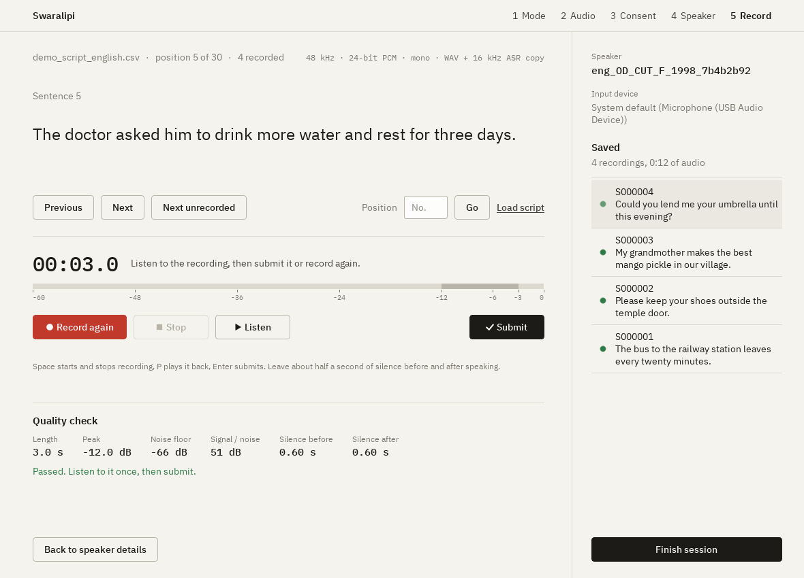
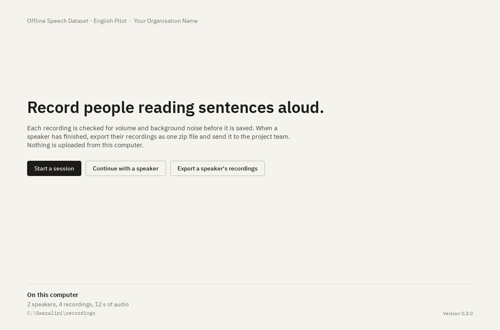
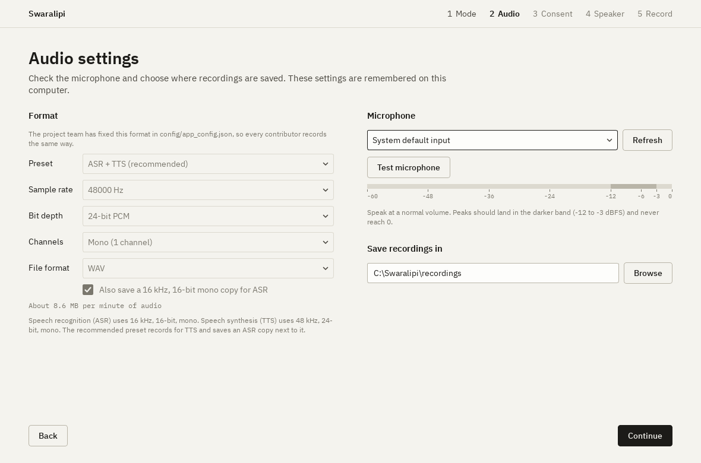
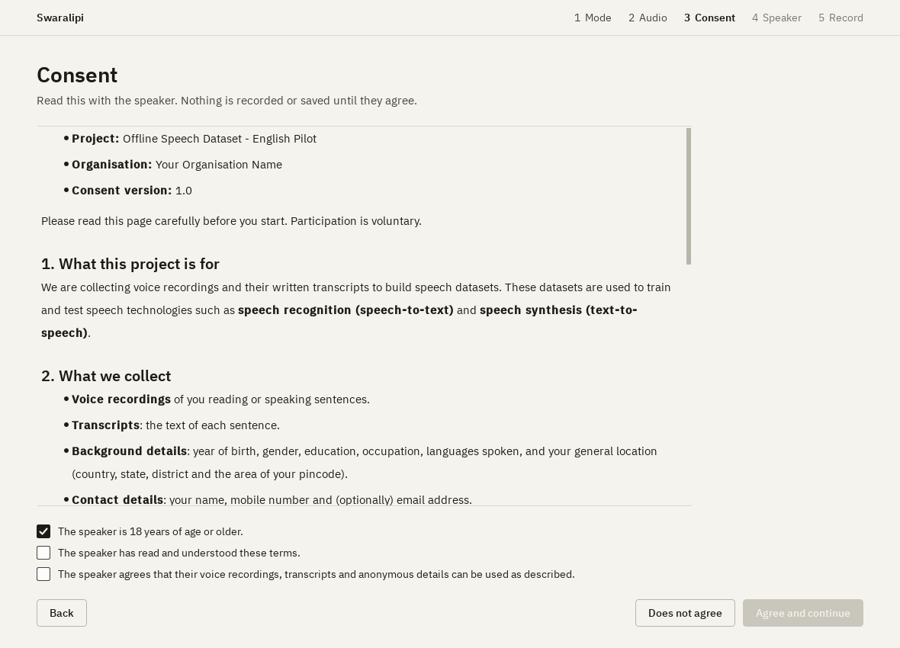
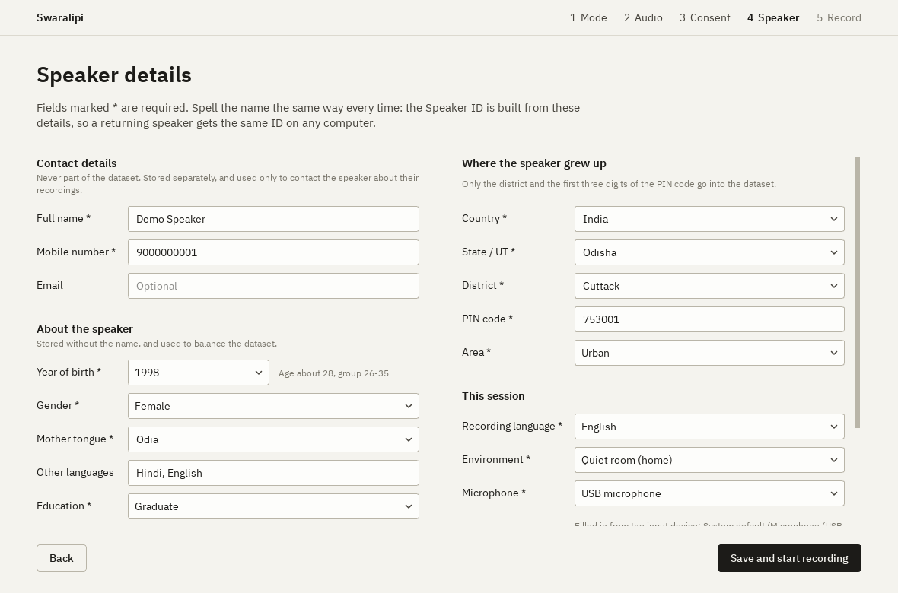

<p align="center">
  
</p>

# Swaralipi

*Swara* (voice) + *lipi* (script): an offline desktop app for recording speech together with
its transcript, to build **speech datasets for ASR and TTS**.

Contributors record on their own computer and send back **one zip per speaker**. The project
team merges all zips with one command. Nothing is uploaded and no server is needed.

<p align="center">
  
</p>

---

## Download

**Windows (no Python needed):** go to
[**Releases**](https://github.com/diptiman-mohanta/swaralipi/releases/latest), download
`Swaralipi-v…-windows.zip`, unzip it and double-click **`Swaralipi.exe`**.

> Windows may say *"Windows protected your PC"* because the app is new and not code-signed.
> Click **More info**, then **Run anyway**.

**Linux / macOS, or running from source:** download the code and run `./run.sh` (macOS / Linux)
or `run.bat` (Windows). The first start creates a private Python environment and installs the
exact package versions from `requirements.txt`. This needs internet **once**; after that
everything works offline. You need **Python 3.10 or newer**. Linux also needs
`sudo apt install libportaudio2`.

---

## How to record

| | |
|---|---|
|  | **1. Start a session** and choose a mode: *type a sentence, then read it aloud*, or *read sentences from a script file* (`.xlsx` / `.csv` with `sentence_no, sentence` columns, see [samples/](samples/)). |
|  | **2. Audio settings.** Pick the microphone, click **Test microphone** and check the level. The format is fixed by the project. |
|  | **3. Consent.** Read the terms with the speaker. Nothing is recorded until they agree. |
|  | **4. Speaker details.** Name, mobile and email stay private. Everything else is anonymous and builds the Speaker ID. |
|  | **5. Record.** Record, Stop, Listen, Submit. Every take gets an automatic quality check. |

**Then send it:** click **Finish session → Export zip now**. The zip is saved in
`recordings/submissions/`. **The app never sends anything over the internet.** You share the
zip yourself, by Google Drive, email or pen drive, as the app's export screen tells you.

| Key | Action |
|---|---|
| Space | Start / stop recording |
| P | Listen |
| Enter | Submit |
| ← / → | Previous / next sentence (script mode) |
| Ctrl+Enter | Confirm a typed sentence |

**Tips for good recordings:** quiet room, fans off, microphone 10–15 cm from the mouth, wired
headset or USB microphone rather than Bluetooth. Wait half a second after pressing Record
before speaking, and pause half a second before Stop. Read exactly what is written.

**Built-in safeguards:**
- The microphone type is filled in from the selected input device.
- Bluetooth microphones trigger a warning, because they record in a low-quality call mode.
- If the sentences are in a different script from the recording language (for example an
  English script with the language set to Odia), the app asks you to correct the language.
- If a typed sentence contains the speaker's name, mobile number or email, the app asks
  before accepting it.
- If a returning speaker's earlier recordings used a different audio format, the app warns
  or offers to switch back so their recordings match.

---

## Output format

```
recordings/<speaker_id>/
  audio/<sentence_id>.wav        master recording (48 kHz / 24-bit / mono by default)
  audio_16k/<sentence_id>.wav    16 kHz / 16-bit / mono copy for ASR
  transcripts.xlsx               sentence_id | sentence
  manifest.csv / manifest.jsonl  one row per clip: text, paths, duration, audio format,
                                 anonymous speaker metadata, quality metrics
  speaker.json                   anonymous speaker profile
  consent.json                   consent records (version, text hash, timestamp)
  private/contact.enc            name / mobile / email / full PIN, encrypted - never published
```

### IDs: unique without a server

```
Speaker ID:   eng_OD_KHO_M_1999_7f3a9c2e
              │   │  │   │ │    └ fingerprint: first 8 hex of SHA-256(name, birth year,
              │   │  │   │ │      gender, PIN, mobile). One-way, cannot be reversed.
              │   │  │   │ └ birth year
              │   │  │   └ gender (M / F / O / X)
              │   │  └ district code
              │   └ state code
              └ language (ISO 639-3)

Sentence ID:  <speaker_id>_S000123        script mode (sentence number from the script)
              <speaker_id>_F261028153012  typed mode (yymmddHHMMSS)
```

The same person entering the same details on any computer gets the same Speaker ID. Different
people practically never collide.

### Privacy

- Name, mobile, email and the full PIN code are **never** written to the dataset files. They are
  stored only in `private/`, encrypted with the project's public key
  ([config/public_key.pem](config/public_key.pem)). Only the project team's private key can
  read them.
- Dataset metadata keeps only the first 3 digits of the PIN code (a broad region), plus birth
  year, gender, district and the other anonymous fields.

---

## For the project team

### Settings

- **[config/app_config.json](config/app_config.json):** organisation name, project name, contact
  email for withdrawal requests, minimum age, and `locked_audio_preset`.
  `locked_audio_preset` fixes the audio format for every contributor so the dataset never mixes
  formats. It is `"ASR + TTS (recommended)"`. Use `"ASR only"`, `"TTS only"`, or `null` to let
  contributors choose. Set `submission_instructions` to tell contributors exactly how to send
  their zip, for example `"Upload the zip to https://drive.google.com/… or email it to
  data@example.org"`. Left empty, the export screen shows the organisation name and contact
  email. In the Windows app, this folder sits next to `Swaralipi.exe`.
- **[config/consent.md](config/consent.md)** is a template. Review it with your legal / ethics
  team and change `consent_version` whenever you change the text.

### Encryption keys

`config/public_key.pem` is this project's public key. The matching private key is kept by the
project owner, outside the repository (`keys/` is git-ignored). **Back it up**: without it,
contact details in submissions cannot be read.

> **Running your own collection with a fork?** Delete `config/public_key.pem` and run
> `.venv\Scripts\python tools\generate_keys.py` to create your own key pair, otherwise your
> contributors' contact details would be encrypted for this project instead of yours.

### Merge received zips

```
.venv\Scripts\python tools\merge_submissions.py <folder-with-zips> <output-folder> --private-key keys\private_key.pem
```

This verifies SHA-256 checksums and merges speakers who sent several zips. It writes a master
`transcripts.xlsx`, `manifest.csv/.jsonl`, `speakers.csv` and `merge_report.txt`. The report
flags damaged files, missing consent, the same person under different IDs, and repeated
sentences. Contact details go to `PRIVATE_contacts.xlsx`, which is **internal only: never
include it in a release.**

### Quality targets used by the automatic check

| Metric | Target |
|---|---|
| Peak level | −20 to −1 dBFS, no clipping |
| SNR | ≥ 25 dB (ASR), ≥ 35 dB (TTS) |
| Noise floor | below −45 dBFS (ideally below −60) |
| Silence before / after speech | 0.2–3 s |
| Clip length | 1–30 s |

---

## Development

```
python -m venv .venv
.venv\Scripts\pip install -r requirements-dev.txt
.venv\Scripts\python app.py                     # run the app
.venv\Scripts\python -m pytest                  # run the tests (no microphone needed)
.venv\Scripts\python tools\build_windows.py     # build dist\Swaralipi-v<version>-windows.zip
.venv\Scripts\python tools\make_screenshots.py  # refresh the README screenshots
```

`requirements.txt` pins the exact versions the app needs (tested with Python 3.10.11 on
Windows 11). `requirements-dev.txt` adds the test and build tools.

**Releasing a new version:**
1. Set `APP_VERSION` in [recorder/\_\_init\_\_.py](recorder/__init__.py), e.g. `0.3.0`.
2. Commit, then tag and push:
   `git tag -a v0.3.0 -m "Swaralipi v0.3.0"` and `git push origin main --follow-tags`.
3. GitHub Actions runs the tests, builds the Windows app, checks that it starts, and publishes
   it on the Releases page. Every push to `main` also runs the tests.

The interface uses IBM Plex Sans and IBM Plex Mono, bundled in
[recorder/ui/fonts/](recorder/ui/fonts/). District lists are in
[data/india_locations.json](data/india_locations.json). The dropdowns are editable, so newly
created districts can be typed in.

---

## License

[MIT](LICENSE) © 2026 Diptiman Mohanta. The bundled IBM Plex fonts are under the SIL Open Font
License.
